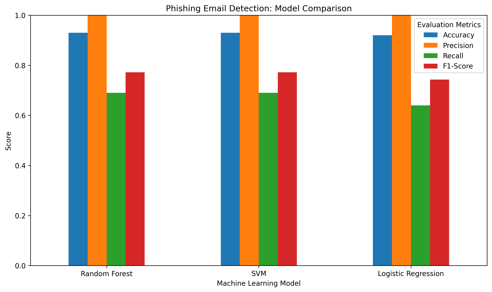

Phishing Email Detection System

1. Project Overview

The Phishing Email Detection System is a machine learning project designed to classify emails as either phishing or safe. It uses text processing and machine learning algorithms to identify patterns in email content that may indicate phishing activity.

The project compares three machine learning models to evaluate their performance in phishing email classification.

2. Objectives

- Analyse email text to identify patterns associated with phishing and safe emails.
- Apply TF-IDF (Term Frequency-Inverse Document Frequency) to convert email text into numerical features.
- Train and evaluate Logistic Regression, Random Forest, and Support Vector Machine (SVM) models.
- Compare model performance using accuracy, precision, recall, and F1-score.
- Identify limitations and opportunities for improving phishing email detection.

3. Technologies Used

- **Programming Language:** Python
- **Data Processing:** Pandas
- **Machine Learning:** Scikit-learn
- **Text Feature Extraction:** TF-IDF
- **Data Visualisation:** Matplotlib
- **Development Environment:** Jupyter Notebook in Visual Studio Code
- **Version Control:** Git and GitHub

4. Dataset

The project uses the `phishing_validation_emails.csv` dataset.

The original dataset contains 2,000 rows. However, many email texts are duplicated. After removing duplicate email texts, the dataset contains 100 unique emails:

- **Safe emails:** 77
- **Phishing emails:** 23

The dataset is imbalanced, with more safe emails than phishing emails. This limitation is considered when interpreting the evaluation results.

5. Methodology

a. Data Preparation

The email dataset was loaded using Pandas. Duplicate email texts were removed to reduce the risk of evaluating models on repeated examples.

b. Text Preprocessing and Feature Extraction

TF-IDF was used to convert email text into numerical features that machine learning algorithms can process. The vectoriser was fitted separately within each cross-validation training fold to reduce data leakage.

c. Model Training

Three machine learning algorithms were evaluated:

- **Logistic Regression:** A linear classification algorithm used as a baseline.
- **Random Forest:** An ensemble learning algorithm that combines multiple decision trees.
- **Support Vector Machine (SVM):** A classification algorithm that identifies a decision boundary between classes.

d. Model Evaluation

Five-fold stratified cross-validation was used to maintain the approximate class distribution across folds. The models were compared using four evaluation metrics:

- **Accuracy:** The proportion of all predictions that were correct.
- **Precision:** The proportion of emails predicted as phishing that were actually phishing.
- **Recall:** The proportion of actual phishing emails correctly identified.
- **F1-score:** The harmonic mean of precision and recall.

6. Model Comparison Results

The following table presents the mean scores obtained through five-fold stratified cross-validation.

| Model | Accuracy | Precision | Recall | F1-score |
|---|---:|---:|---:|---:|
| Random Forest | 93% | 100% | 69% | 77.2% |
| SVM | 93% | 100% | 69% | 77.2% |
| Logistic Regression | 92% | 100% | 64% | 74.3% |

7. Model Comparison Chart

Word Cloud Analysis

Phishing Emails
This word cloud highlights frequently occurring terms in phishing emails.

Safe Emails
This word cloud highlights frequently occurring terms in safe emails.

Interpretation

The word clouds provide a visual comparison of frequently occurring words in phishing and safe emails. They help identify common vocabulary and potential patterns in the email text.

- Phishing emails:Frequently occurring words may relate to urgency, account verification, security alerts, or requests for action.
- Safe emails:Frequently occurring words may reflect ordinary communication, general information, or routine activities.

Word clouds are useful for exploratory text analysis, but word frequency alone cannot determine whether an email is malicious. The findings should be interpreted alongside the machine learning model evaluation results.

Limitation: The dataset contains repetitive email text and a relatively small number of unique examples. Therefore, these visual patterns should be treated as preliminary rather than representative of all phishing and safe emails.

8. Results Discussion

Random Forest and SVM achieved the highest mean accuracy at 93% and the highest mean F1-score at 77.2%. Both models performed similarly across the evaluated metrics.

Logistic Regression achieved a mean accuracy of 92% and an F1-score of 74.3%.

All three models achieved a mean precision of 100%. However, Random Forest and SVM achieved a mean recall of 69%, while Logistic Regression achieved 64%. This indicates that the models did not identify every phishing email during cross-validation.

The results suggest that Random Forest and SVM are the strongest candidates among the three models tested. However, their similar scores do not establish that either model is definitively superior.

9. Limitations

- The dataset contains only 100 unique email texts.
- The dataset is imbalanced, with 77 safe emails and 23 phishing emails.
- Repetitive email templates may make classification easier than it would be on diverse, real-world emails.
- The limited number of unique examples means that the evaluation results may vary substantially with different data.
- High precision on this dataset does not guarantee that the models will avoid false phishing alerts in real-world use.

10. Future Improvements

- Evaluate the models on a larger and more diverse email dataset.
- Include more realistic phishing examples and varied safe emails.
- Investigate methods for improving phishing recall.
- Examine confusion matrices and per-fold evaluation scores.
- Test the best-performing models on previously unseen emails.
- Explore additional text features and machine learning algorithms.

11. Project Files

- `phishing_validation_emails.csv` — Original email dataset.
- `cleaned_phishing_emails.csv` — Cleaned email dataset.
- `phishing_email_detection.ipynb` — Jupyter Notebook containing the analysis and model evaluation.
- `model_comparison.png` — Visual comparison of the machine learning models.

12. Conclusion

This project explored the use of machine learning for phishing email classification by comparing Logistic Regression, Random Forest, and SVM using five-fold stratified cross-validation. Random Forest and SVM achieved the highest mean accuracy and F1-score on the available dataset.

The small dataset and its repetitive email templates limit the conclusions that can be drawn about real-world performance. Further testing on a larger and more diverse dataset is necessary to assess the reliability of the models for practical phishing detection.
